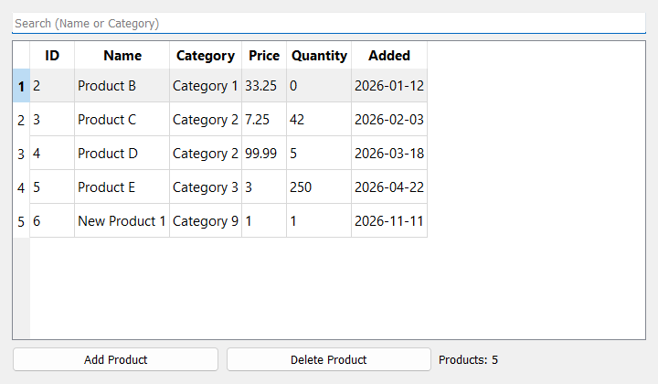

# WinCOM Package

## Overview

WinCOM package for the Ring programming language

COM (Component Object Model) is the MS-Windows technology that lets programs use objects provided by other programs and libraries. Many Windows components and applications provide COM objects:

- **ADO** (`ADODB.Connection`, `ADODB.Recordset`, `ADODB.Command`, ...) and **ADOX** (`ADOX.Catalog`): databases like Microsoft Access, SQL Server, Excel files, ... using OLE DB providers
- **Scripting** (`Scripting.Dictionary`, `Scripting.FileSystemObject`) and **WScript** (`WScript.Shell`)
- **WMI** (`winmgmts:`): system information and management
- **Microsoft Office** (`Excel.Application`, `Word.Application`, `Outlook.Application`, ...)

This package uses COM Automation (late binding using the `IDispatch` interface, like VBScript and Visual Basic), so any COM object that supports Automation can be used from Ring:

```ring
load "wincom.ring"

oConnection = com_createobject("ADODB.Connection")
com_invoke(oConnection, "Open", "Provider=Microsoft.ACE.OLEDB.12.0;Data Source=C:\Data\Shop.accdb")
oRecordset = com_invoke(oConnection, "Execute", "SELECT Name, Price FROM Products")
while ! com_get(oRecordset, "EOF")
	? com_get(oRecordset, 'Fields("Name").Value') + " : " + 
	  com_get(oRecordset, 'Fields("Price").Value')
	com_invoke(oRecordset, "MoveNext")
end
com_invoke(oConnection, "Close")
```

## Installation

	ringpm install wincom from ringpackages

The package includes `ring_wincom.dll` (64-bit) for MS-Windows. COM is available on MS-Windows only.

The Microsoft Access samples need the **Microsoft Access Database Engine** (the ACE OLE DB provider). It's installed with Microsoft Office, or can be installed using the *Microsoft Access Database Engine Redistributable*. Ring 64-bit needs the 64-bit engine. Ring 32-bit can also use the `Microsoft.Jet.OLEDB.4.0` provider (`.mdb` files), which is part of MS-Windows.

## Features

- Create COM objects using the ProgID (`"ADODB.Connection"`) or the CLSID (`"{...}"`), get objects using monikers (`"winmgmts:"`, file names) or the running instance (`Excel.Application`)
- Get and set properties, call methods, with any number of arguments
- Paths: `"Fields.Count"`, `'Fields("Name").Value'`, `"Cells(2, 3).Value"` (one call instead of many)
- Automatic conversion between Ring values and `VARIANT` values: numbers, UTF-8 strings (including `char(0)`), lists (arrays with many dimensions), COM objects, dates, booleans, binary data
- Values that don't exist in Ring: `com_null()`, `com_empty()`, `com_missing()` (optional parameters), `com_bool()`, `com_date()`, `com_currency()`, `com_bytes()`, `com_variant()`
- Enumerate collections (like `For Each` in Visual Basic) using `com_items()`
- ByRef (output) arguments using `com_byref()` and `com_byrefvalue()`, like `RecordsAffected` in `Connection.Execute()`
- Named arguments (like `Name:=Value` in Visual Basic) using `com_named()`
- COM events (connection points): run Ring code when the object raises an event, read the event arguments and change the ByRef arguments (like cancelling an ADO command or closing an Excel workbook). Errors in the event handlers are raised by the function that caused the event
- COM objects are released by the Ring garbage collector, or now using `com_release()`
- COM errors (with the description provided by the object, like the database engine error messages) are Ring errors, so they can be caught using `try/catch`
- Object-Oriented Programming using the `COMObject` and `COMEvents` classes
- Explore objects: `com_typename()` and `com_members()` (from the type information)
- ADO and ADOX constants (`adOpenKeyset`, `adLockOptimistic`, `adVarWChar`, `adSchemaTables`, ...)
- Samples that use ADO, ADOX, DAO and JRO with Microsoft Access databases (create databases and tables, insert/update/delete, parameters, editing records, transactions, schema, saved queries, events, errors, export to CSV/XML/Excel, compacting, and a GUI application using RingQt), Microsoft Excel and Word automation, MSXML and a COM objects explorer
- Two dimensions arrays (`com_matrix()`), like `Range.Value` in Microsoft Excel: write or read all the cells in one call
- Read the constants (enumerations) of type libraries using `com_constants()`, like `adOpenStatic`, `xlBarClustered` or `wdFormatPDF`, and generate Ring files that define them
- Can be used from many threads (RingThreads): each thread has its own COM apartment and state
- Create objects on other computers (DCOM) using `com_createobject(cProgID, cServer)`


## Quick Start

### Using the functions

```ring
load "wincom.ring"

oDict = com_createobject("Scripting.Dictionary")

com_invoke(oDict, "Add", "apple", 5)               # Call a method
com_set(oDict, 'Item("orange")', 12)               # Set a property
? com_get(oDict, "Count")                          # 2
? com_get(oDict, 'Item("apple")')                  # 5
? com_get(oDict, "Item", "orange")                 # 12 (Arguments after the name)
? com_invoke(oDict, "Keys")                        # ["apple", "orange"]
```

### Using the COMObject class

```ring
load "wincom.ring"

oShell = new COMObject("WScript.Shell")
? oShell.invoke("ExpandEnvironmentStrings", ["%WINDIR%"])

oDict = new COMObject("Scripting.Dictionary")
oDict {
	invoke("Add", ["one", 1])
	setPropArgs("Item", ["two"], 2)
	? getProp("Count")                             # 2
}
```

### Creating a Microsoft Access database

```ring
load "wincom.ring"

cConnection = "Provider=Microsoft.ACE.OLEDB.12.0;Data Source=" + currentdir() + "\Shop.accdb"

# ADOX.Catalog.Create() creates the file and returns an open ADODB.Connection
oCatalog = com_createobject("ADOX.Catalog")
oConnection = com_invoke(oCatalog, "Create", cConnection)

com_invoke(oConnection, "Execute", "CREATE TABLE Products (ID COUNTER PRIMARY KEY, Name TEXT(50), Price CURRENCY, Added DATETIME)")
com_invoke(oConnection, "Execute", "INSERT INTO Products (Name, Price, Added) VALUES ('Product A', 10.5, #2026-01-05#)")

# Add records using a Recordset
oRecordset = com_createobject("ADODB.Recordset")
com_invoke(oRecordset, "Open", "Products", oConnection, adOpenKeyset, adLockOptimistic, adCmdTable)
com_invoke(oRecordset, "AddNew", ["Name", "Price", "Added"], ["Product B", 25, com_date("2026-02-01")])
com_invoke(oRecordset, "Close")

# Read all the records in one call: aColumns[nField][nRow]
oRecordset = com_invoke(oConnection, "Execute", "SELECT Name, Price, Added FROM Products")
aRows = com_rowsfromcolumns(com_invoke(oRecordset, "GetRows"))
for aRow in aRows
	? aRow[1] + " | " + aRow[2] + " | " + aRow[3]
next
com_invoke(oRecordset, "Close")
com_invoke(oConnection, "Close")
```

Output:

```
Product A | 10.50 | 2026-01-05
Product B | 25 | 2026-02-01
```

### Events

```ring
oEvents = com_connectevents(oConnection)                  # ADODB.Connection events
com_onevent(oEvents, "WillExecute", "onWillExecute()")

func onWillExecute
	aArgs = com_eventargs()                                # [Source, CursorType, LockType, Options, adStatus, ...]
	? "SQL: " + aArgs[1]
	if substr(upper(aArgs[1]), "DROP ")
		com_seteventarg(5, adStatusCancel)                 # Cancel the command
	ok
```

### ByRef and named arguments

```ring
oAffected = com_byref(0)
com_invoke(oConnection, "Execute", "DELETE FROM Products WHERE Quantity = 0", oAffected)
? "Deleted: " + com_byrefvalue(oAffected)

com_invoke(oRecordset, "Open", com_named("Source", "Products"), com_named("ActiveConnection", oConnection),
	   com_named("CursorType", adOpenStatic))
```

### Using parameters

```ring
oCommand = com_createobject("ADODB.Command")
com_setref(oCommand, "ActiveConnection", oConnection)        # Like: Set oCommand.ActiveConnection = oConnection
com_set(oCommand, "CommandText", "SELECT Name FROM Products WHERE Price >= ?")
com_invoke(oCommand, "Parameters.Append",
	com_invoke(oCommand, "CreateParameter", "pPrice", adCurrency, adParamInput, 0, 20))
oRecordset = com_invoke(oCommand, "Execute")
```

## Samples

The samples are in `ring/samples/UsingWinCOM`.

| Sample | Description |
|--------|-------------|
| `test01_scripting_dictionary.ring` | `com_createobject()`, `com_invoke()`, `com_get()`, `com_set()`, `com_items()` using `Scripting.Dictionary` |
| `test02_filesystemobject.ring` | Drives, folders and Unicode text files using `Scripting.FileSystemObject` |
| `test03_comobject_class.ring` | The `COMObject` class: `WScript.Shell`, environment variables, running commands, braces, members |
| `test04_create_access_database.ring` | Create a Microsoft Access database (ADOX), create tables and indexes (SQL), read the structure (ADOX Catalog) |
| `test05_insert_and_select.ring` | `INSERT`, `UPDATE`, `DELETE`, `SELECT`, fields, Null values and aggregate functions |
| `test06_parameters.ring` | `ADODB.Command` with parameters (Unicode, quotes and SQL injection are safe) |
| `test07_recordset_editing.ring` | `ADODB.Recordset`: `AddNew`, `Update`, `Delete`, `Find`, `Filter`, `Sort` |
| `test08_getrows_and_schema.ring` | `GetRows()`, `com_rowsfromcolumns()`, `OpenSchema()` (tables and columns) |
| `test09_transactions.ring` | `BeginTrans()`, `CommitTrans()`, `RollbackTrans()` |
| `test10_errors.ring` | Errors from COM objects and from the database engine, `Connection.Errors` |
| `test11_export_data.ring` | Export to CSV (`GetString()` + `ADODB.Stream`) and XML (`Recordset.Save()`), binary data |
| `test12_access_to_excel.ring` | Copy the data of an Access database to an Excel workbook (needs Microsoft Excel) |
| `test13_unit_tests.ring` | Unit tests |
| `test14_wmi.ring` | System information using WMI (`com_getobject("winmgmts:")`) |
| `test15_byref_and_named_args.ring` | `com_byref()` (`RecordsAffected`) and `com_named()` (`Recordset.Open()` with named arguments) |
| `test16_ado_events.ring` | ADO events: log the SQL statements and cancel `DROP` statements |
| `test17_excel_events.ring` | Excel events: `SheetChange`, `NewWorkbook`, cancel `BeforeClose` (needs Microsoft Excel) |
| `test18_adox_objects.ring` | Create tables, primary and foreign keys and indexes using the ADOX objects |
| `test19_access_queries.ring` | Saved queries: views, parameter queries and action queries |
| `test20_compact_database.ring` | Compact a database using DAO (`.accdb`) or JRO (`.mdb`, Ring 32-bit) |
| `test21_products_gui.ring` | A GUI application (RingQt): search, add, delete and edit the records of an Access table |
| `test22_excel_2d_arrays.ring` | Export to Excel using `com_matrix()` (one call for all the cells), formats, a formula and a chart (needs Microsoft Excel) |
| `test23_word_report.ring` | A Word report (heading, paragraph and table) from an Access table, saved as `.docx` and `.pdf` (needs Microsoft Word) |
| `test24_msxml.ring` | XML using MSXML: create, save, load, XPath queries and parse errors |
| `test25_com_explorer.ring` | Print the properties, methods (with the parameter names and descriptions) and events of a COM object (`ring test25_com_explorer.ring ADODB.Connection`) |
| `test26_generate_constants.ring` | Read the constants of a type library using `com_constants()` and generate a Ring file (`ring test26_generate_constants.ring Excel.Application excelconstants.ring`) |
| `test27_excel_and_csv_files.ring` | Create and read Excel workbooks and CSV files using ADO (without Microsoft Excel), and import prices from a workbook into an Access table |
| `test28_threads.ring` | Using COM objects from many threads (RingThreads) |
| `test29_wmi_events.ring` | Asynchronous WMI events: know when processes start and stop (`WbemScripting.SWbemSink` and `com_processmessages()`) |
| `test30_files_in_access.ring` | Store files (binary data) in an Access table, read them using `Field.Value` and `GetChunk()`, and save them using `ADODB.Stream` |
| `test31_shell_application.ring` | Windows Shell (`Shell.Application`): folder items, the details that Windows Explorer shows, properties and verbs |

The Microsoft Access samples use `accesshelper.ring`. It selects the provider (`Microsoft.ACE.OLEDB.16.0`, `Microsoft.ACE.OLEDB.12.0` or `Microsoft.Jet.OLEDB.4.0`), creates the sample database and the `Products` table, and prints Recordsets as tables. The samples delete the database files at the end. The Office samples keep the files that they create (`products.xlsx`, `products_2d.xlsx`, `products_report.docx` and `products_report.pdf`), and `test26_generate_constants.ring` keeps the generated file (`adoconstants.ring`).

Screen shot of `test21_products_gui.ring`:



Output of `test05_insert_and_select.ring` (first part):

```
All the products:

ID | Name      | Category   | Price | Quantity | Added      | InStock | Notes
---+-----------+------------+-------+----------+------------+---------+--------------
1  | Product A | Category 1 | 10.50 | 100      | 2026-01-05 | 1       | First product
2  | Product B | Category 1 | 25    | 0        | 2026-01-12 | 0       | (Null)
3  | Product C | Category 2 | 7.25  | 42       | 2026-02-03 | 1       | Fragile
4  | Product D | Category 2 | 99.99 | 5        | 2026-03-18 | 1       | (Null)
5  | Product E | Category 3 | 3     | 250      | 2026-04-22 | 1       | Sold in packs
```

## API Reference

### Creating and Getting Objects

| Function | Description |
|----------|-------------|
| `com_createobject(cProgID, [cServer])` | Create a COM object (like `CreateObject()` in Visual Basic). `cProgID` is a ProgID (`"ADODB.Connection"`) or a CLSID (`"{EE09B103-97E0-11CF-978F-00A02463E06F}"`). `cServer` is the computer name to create the object on another computer (DCOM): the class must be registered on this computer too (or use the CLSID), and it must be an out-of-process server |
| `com_getobject(cName)` | Get an object using a moniker (like `GetObject()`): `"winmgmts:"`, `"winmgmts:root\cimv2"`, a file name (`"C:\Data\Book.xlsx"`), ... |
| `com_getactiveobject(cProgID)` | Get the running instance of an application (for example `"Excel.Application"`) |
| `com_progidexists(cProgID)` | Return `1` if the ProgID (or the CLSID) is registered |
| `com_init()` | Initialize COM in the current thread (Single-Threaded Apartment); called automatically by the other functions; return `1` on success |

### Properties and Methods

| Function | Description |
|----------|-------------|
| `com_get(oObject, cPath, [Arguments...])` | Get a property value (or call a method that returns a value) |
| `com_set(oObject, cPath, [Arguments...], vValue)` | Set a property value. If the value is a COM object and the property doesn't support it, `com_setref()` is used |
| `com_setref(oObject, cPath, [Arguments...], oValue)` | Set a property to a COM object (like `Set oObject.Property = oValue` in Visual Basic) |
| `com_invoke(oObject, cPath, [Arguments...])` | Call a method; return the result (or `""`) |
| `com_dispatch(oObject, cPath, nMode, aArguments)` | Like the functions above, but the arguments are a Ring list. `nMode` is `COM_GET`, `COM_INVOKE`, `COM_SET` or `COM_SETREF` (for `COM_SET` the value is the last item) |
| `com_items(oObject)` | Return a list of the items of a collection (using `_NewEnum`, like `For Each` in Visual Basic) |

`cPath` is a member name, or a path of members separated by dots. Each member can have arguments (numbers, or strings between `"` or `'`; write a quote two times inside a string):

```ring
com_get(oRecordset, "Fields.Count")
com_get(oRecordset, 'Fields("Name").Value')
com_get(oRecordset, "Fields(0).Name")
com_set(oSheet, "Cells(2, 3).Value", 100)
com_get(oFSO, 'GetFolder("C:\Windows").Files.Count')
com_get(oDict, "Item('it''s')")
```

The arguments after `cPath` are added after the arguments written in the last member: `com_get(oDict, "Item", cKey)` is the same as `com_get(oDict, 'Item("key")')`. The empty name is the default member (`DISPID_VALUE`). Member names are not case sensitive.

### ByRef and Named Arguments

| Function | Description |
|----------|-------------|
| `com_byref(vValue)` | Create an argument passed by reference (`VT_BYREF`). The member can change the value |
| `com_byrefvalue(oByRef)` | Return the current value of the argument (after calling the member) |
| `com_named(cName, vValue)` | Create a named argument. Named arguments come after the other arguments, can be in any order, and can't be used with `com_set()`/`com_setref()` or inside lists |

### Events

| Function | Description |
|----------|-------------|
| `com_connectevents(oObject, [cInterface])` | Connect to the events of the object; return the events object (C pointer). `cInterface` is the name of the events interface (like `"ConnectionEvents"`, `"WorkbookEvents"`) or its IID (`"{...}"`). Without it the default events interface is used |
| `com_onevent(oEvents, cEvent, cCode)` | Run the Ring code `cCode` when the event happens. `cEvent` is the event name (not case sensitive) or `"*"` for all the events. `""` code removes the handler |
| `com_eventnames(oEvents)` | Return the names of the events |
| `com_disconnectevents(oEvents)` | Stop receiving the events (also done by the Ring garbage collector and `com_release()`) |
| `com_eventname()` | In the handler: the name of the current event |
| `com_eventargs()` | In the handler: the list of the event arguments |
| `com_seteventarg(nIndex, vValue)` | In the handler: change a ByRef argument (`nIndex` starts from 1), like `adStatus` in ADO events or `Cancel` in Excel events |
| `com_seteventresult(vValue)` | In the handler: the return value of the event (few events use it) |
| `com_processmessages([nMilliseconds])` | Process the Windows messages (like `DoEvents` in Visual Basic), and wait `nMilliseconds` (default: `0`). Return the number of processed messages |

Events from in-process objects (like ADO) happen while we call their methods. Events from other programs (like Excel) happen while we call their methods, while `com_processmessages()` runs, or in the event loop of a GUI library (like RingQt). The handler runs inside `try/catch`: if it raises an error, the error is raised again by the `com_*()` function that was running when the event happened (`Error, WinCOM: Event <Name> : <Error>`). This is usually the function that caused the event, but events from other programs can also arrive while any `com_*()` function waits for another program. If the event didn't happen during a `com_*()` function (for example in the event loop of RingQt), the error is printed and the program continues.

### Objects

| Function | Description |
|----------|-------------|
| `com_isobject(vValue)` | Return `1` if the value is a COM object (not released) |
| `com_release(oObject)` | Release the COM object now (or the value created by `com_variant()`, `com_byref()`, `com_named()`, `com_connectevents()`). All the copies of the variable can't be used after that. The Ring garbage collector releases the objects automatically |
| `com_typename(oObject)` | Return the interface name (like `_Connection`, `_Recordset`, `IDictionary`), or `""` |
| `com_members(oObject)` | Return a list of the members: `[cName, cKind, nParameters, cDescription, aParameterNames]`, `cKind` is `"method"`, `"get"`, `"put"`, `"putref"` or `"property"`. The description is `""` if the type library doesn't have it |
| `com_issame(oObject1, oObject2)` | Return `1` if the two values are the same COM object (COM identity) |
| `com_constants(vSource)` | Return the constants of a type library: `[cEnumeration, cName, vValue]`. `vSource` is a COM object (its type library) or a type library file name (like `"msado15.dll"`) |
| `com_refcount(oObject)` | Return the reference count of the COM object (used by the unit tests) |

### Values

| Function | Description |
|----------|-------------|
| `com_null()` | Null (for example to store Null in a database field) |
| `com_empty()` | Empty |
| `com_missing()` | Missing optional parameter: skip a parameter and pass the next one, like `oRecordset.GetRows(adGetRowsRest, , aFields)` |
| `com_bool(lValue)` | Boolean (`0` is False, other numbers are True) |
| `com_date(cDate)` | Date: `"YYYY-MM-DD"`, `"YYYY-MM-DD HH:MM"`, `"YYYY-MM-DD HH:MM:SS"` or `"YYYY-MM-DDTHH:MM:SS"`. Other formats are converted by COM (using the regional settings) |
| `com_currency(nValue)` | Currency (four digits after the decimal point) |
| `com_double(nValue)` | Double (numbers without fractions are passed as Long by default) |
| `com_bytes(cData)` | Binary data (byte array) from a Ring string |
| `com_variant(nVarType, vValue)` | Convert the value to the `VARIANT` type `nVarType` (`VT_I2`, `VT_I4`, `VT_R4`, `VT_R8`, `VT_CY`, `VT_DATE`, `VT_BSTR`, `VT_BOOL`, `VT_DECIMAL`, ...). Strings are converted using the invariant locale (the decimal separator is `.`). For `VT_ERROR` the value is a 32-bit error code, signed or unsigned (like `com_lasthresult()`). For typed arrays use `VT_ARRAY + nType` with a list: `com_variant(VT_ARRAY + VT_BSTR, ["a", "b"])` (each item is converted to the type) |
| `com_lasttype()` | Return the `VARIANT` type of the last value returned by `com_get()`, `com_invoke()` or `com_dispatch()` |
| `com_wasnull()` | Return `1` if the last value was Null |
| `com_lasthresult()` | Return the `HRESULT` code of the last call (`0` is `S_OK`), as an unsigned number (`upper(hex(com_lasthresult()))` gives `"80040E14"`) |
| `com_matrix(aRows)` | Two dimensions array from a list of rows (`[[1, 2], [3, 4]]`), like `Range.Value` in Microsoft Excel (`aRows[nRow][nColumn]`). Short rows are completed using Empty values. Arrays returned by COM objects with two dimensions are lists of rows too |
| `com_rowsfromcolumns(aColumns)` | Convert the output of `Recordset.GetRows()` (`aColumns[nField][nRow]`) to a list of records (`aRows[nRow][nField]`) |
| `com_version()` | Return the package version (`"1.0.0"`) |

### Type Conversion

| Ring | COM (`VARIANT`) |
|------|-----------------|
| Number | `VT_I4` for numbers without fractions in the range of Long, else `VT_R8` |
| String (UTF-8) | `VT_BSTR` (UTF-16). Strings that are not valid UTF-8 are read in the ANSI code page |
| List | `SAFEARRAY` of `VARIANT` (nested lists become arrays inside arrays) |
| COM object | `VT_DISPATCH` |
| `com_null()`, `com_bool()`, `com_date()`, ... | The `VARIANT` created by the function |

| COM (`VARIANT`) | Ring |
|-----------------|------|
| All the number types, `VT_CY`, `VT_DECIMAL` | Number |
| `VT_BOOL` | `1` or `0` |
| `VT_BSTR` | String (UTF-8) |
| `VT_DATE` | String: `"YYYY-MM-DD"` (time is 00:00:00) or `"YYYY-MM-DD HH:MM:SS"` |
| `VT_NULL`, `VT_EMPTY` | `""` (use `com_wasnull()` or `com_lasttype()`) |
| `VT_DISPATCH` | COM object (C pointer, type `COMObject`), `""` for Nothing |
| `VT_UNKNOWN` | COM object if it supports `IDispatch`, else C pointer (type `COMUnknown`) that can be passed to methods |
| Byte array (`VT_ARRAY + VT_UI1`) | String (binary data) |
| Other arrays | List (arrays with many dimensions become nested lists: `aList[nDim1][nDim2]`) |
| `VT_ERROR` | Number (the error code) |

### The COMObject Class

| Method | Description |
|--------|-------------|
| `new COMObject(vValue)` | Create the object: `vValue` is a ProgID, a CLSID or a COM object (C pointer) |
| `getProp(cPath)` | Get a property value |
| `getPropArgs(cPath, aArgs)` | Get a property that has arguments |
| `setProp(cPath, vValue)` | Set a property value |
| `setPropArgs(cPath, aArgs, vValue)` | Set a property that has arguments |
| `setPropRef(cPath, oValue)` | Set a property to a COM object |
| `invoke(cMethod, aArgs)` | Call a method (`aArgs` is a list) |
| `items()` | The items of a collection |
| `typeName()`, `members()` | Like `com_typename()` and `com_members()` |
| `events()` | Return a `COMEvents` object for the default events interface |
| `isSame(oOther)` | Like `com_issame()` |
| `pointer()` | The COM object (C pointer) used by the `com_*()` functions |
| `isValid()` | Return `1` if the object can be used |
| `release()` | Release the COM object now |

The methods return COM objects as `COMObject` objects, and the arguments can be `COMObject` objects, `com_byref()` and `com_named()` values. The setters return `self`.

### The COMEvents Class

| Method | Description |
|--------|-------------|
| `new COMEvents(vValue)` | Connect to the events: `vValue` is a COM object (C pointer or `COMObject`), or `[oObject, cInterface]` |
| `onEvent(cEvent, cCode)` | Like `com_onevent()`, returns `self` |
| `names()` | The names of the events |
| `disconnect()` | Stop receiving the events |
| `pointer()` | The events object (C pointer) used by the `com_*()` functions |

```ring
oEvents = new COMEvents([oWorkbook, "WorkbookEvents"])
oEvents.onEvent("BeforeClose", "? 'Closing'")
```

### Constants

| Constants | Description |
|-----------|-------------|
| `COM_GET`, `COM_INVOKE`, `COM_SET`, `COM_SETREF` | Modes of `com_dispatch()` |
| `VT_EMPTY`, `VT_NULL`, `VT_I2`, `VT_I4`, `VT_R4`, `VT_R8`, `VT_CY`, `VT_DATE`, `VT_BSTR`, `VT_DISPATCH`, `VT_ERROR`, `VT_BOOL`, `VT_VARIANT`, `VT_UNKNOWN`, `VT_DECIMAL`, `VT_I1`, `VT_UI1`, `VT_UI2`, `VT_UI4`, `VT_I8`, `VT_UI8`, `VT_INT`, `VT_UINT`, `VT_ARRAY` | `VARIANT` types |
| `adOpenForwardOnly`, `adOpenKeyset`, `adOpenDynamic`, `adOpenStatic` | ADO cursor types |
| `adLockReadOnly`, `adLockPessimistic`, `adLockOptimistic`, `adLockBatchOptimistic` | ADO lock types |
| `adUseServer`, `adUseClient` | ADO cursor location |
| `adCmdText`, `adCmdTable`, `adCmdStoredProc`, `adCmdUnknown`, `adCmdTableDirect`, `adExecuteNoRecords` | ADO command types and options |
| `adInteger`, `adDouble`, `adCurrency`, `adDate`, `adBoolean`, `adVarWChar`, `adLongVarWChar`, `adLongVarBinary`, ... | ADO data types |
| `adParamInput`, `adParamOutput`, `adParamInputOutput`, `adParamReturnValue` | ADO parameter directions |
| `adStateClosed`, `adStateOpen`, ... | ADO object states |
| `adStatusOK`, `adStatusErrorsOccurred`, `adStatusCantDeny`, `adStatusCancel`, `adStatusUnwantedEvent` | ADO events status (`adStatus` argument) |
| `adSchemaTables`, `adSchemaColumns`, `adSchemaIndexes`, `adSchemaPrimaryKeys` | `Connection.OpenSchema()` |
| `adAffectCurrent`, `adSearchForward`, `adGetRowsRest`, `adPersistXML`, `adSaveCreateOverWrite`, `adTypeBinary`, `adTypeText`, ... | Other ADO constants |
| `adKeyPrimary`, `adKeyForeign`, `adKeyUnique`, `adColNullable` | ADOX constants |

See `globals.ring` for the full list.

### Error Messages

COM errors are raised as Ring errors (they can be caught using `try/catch`):

```
Error, WinCOM: <Member> : <Source> : <Description> (<HRESULT>)
```

For example:

```
Error, WinCOM: Execute : Microsoft Access Database Engine : The Microsoft Access database engine cannot find the input table or query 'NoSuchTable'. Make sure it exists and that its name is spelled correctly (0x80040E37)
Error, WinCOM: NoSuchProperty : Unknown name (0x80020006)
Error, WinCOM: NoSuch.Object : Invalid class string (0x800401F3)
```

| Error | When |
|-------|------|
| `Error, WinCOM: The first parameter must be a COM object` | The object is not a COM object, or it was released |
| `Error, WinCOM: Bad member name or path: ...` | The path is not valid (for example a missing `)` or quote) |
| `Error, WinCOM: <Member> : The value is not a COM object (path: ...)` | A member in the middle of the path doesn't return an object |
| `Error, WinCOM: Ring objects can't be passed to COM (...)` | A Ring object was passed to a `com_*()` function (pass `oObject.pointer()`, or use the `COMObject` methods) |
| `Error, WinCOM: Event <Name> : <Error>` | An error in an event handler (raised by the function that caused the event) |
| `Error, WinCOM: The value is missing` | `com_set()`, `com_setref()` or `com_dispatch()` (`COM_SET`, `COM_SETREF`) without the value after the path |
| `Error, WinCOM: Named arguments (com_named()) must be after the other arguments` | A named argument is before a positional argument |
| `Error, WinCOM: There is no active event (...)` | `com_eventargs()`, `com_eventname()`, `com_seteventarg()` or `com_seteventresult()` is used outside an event handler |
| `Error, WinCOM: The COM technology is available on MS-Windows only` | `load "wincom.ring"` on another platform |

## From VBScript and Visual Basic to Ring

Most COM examples on the web are written in VBScript, VBA or Visual Basic. This table shows the same code using WinCOM:

| VBScript / Visual Basic | Ring (WinCOM) |
|-------------------------|---------------|
| `Set o = CreateObject("ADODB.Connection")` | `o = com_createobject("ADODB.Connection")` |
| `Set o = GetObject("winmgmts:")` | `o = com_getobject("winmgmts:")` |
| `x = o.Property` | `x = com_get(o, "Property")` |
| `x = o.Item("key")` | `x = com_get(o, 'Item("key")')` or `com_get(o, "Item", "key")` |
| `x = rs.Fields("Name").Value` | `x = com_get(rs, 'Fields("Name").Value')` |
| `o.Property = 5` | `com_set(o, "Property", 5)` |
| `Set cmd.ActiveConnection = conn` | `com_setref(cmd, "ActiveConnection", conn)` |
| `o.Method 1, "a"` | `com_invoke(o, "Method", 1, "a")` |
| `x = o.Method(1, "a")` | `x = com_invoke(o, "Method", 1, "a")` |
| `o.Method , , 3` (skipped arguments) | `com_invoke(o, "Method", com_missing(), com_missing(), 3)` |
| `o.Method Name:="x"` | `com_invoke(o, "Method", com_named("Name", "x"))` |
| `For Each x In o.Items ... Next` | `aItems = com_items(com_get(o, "Items"))` then `for x in aItems ... next` |
| `True`, `False` | `com_bool(1)`, `com_bool(0)` |
| `Null` | `com_null()` |
| `#2026-01-05#` (date) | `com_date("2026-01-05")` |
| `If IsNull(x) Then` | `x = com_get(...)` then `if com_wasnull()` |
| `Set o = Nothing` | `com_release(o)` (or let the garbage collector release it) |
| `On Error Resume Next` / `Err.Description` | `try ... catch ... done` / `cCatchError` |
| `Dim WithEvents o` ... `Sub o_Event(...)` | `oEvents = com_connectevents(o)` then `com_onevent(oEvents, "Event", "handler()")` |
| `DoEvents` | `com_processmessages()` |
| Constants like `adOpenStatic` | Defined in `globals.ring` (ADO), or read using `com_constants()` |

Each call costs less than 1 microsecond for in-process objects (like `Scripting.Dictionary` and ADO), including the path.

## Using COM from Threads

Each thread has its own COM apartment (Single-Threaded Apartment) and its own state (the last error, the last type, the current event). COM is initialized for each thread by the first `com_*()` function that it calls. Create the COM objects in the thread that uses them: don't pass a COM object from one thread to another (see `test28_threads.ring`).

## Notes about Microsoft Access

These notes are about the Microsoft Access Database Engine (ACE). The same problems happen in VBScript and Visual Basic:

- Use `adDate` (not `adDBTimeStamp`) for date parameters. With `adDBTimeStamp` the day and the month may be swapped (depends on the regional settings).
- Executing the same `INSERT` command again with new parameter values may swap the day and the month of dates, or fail with Boolean values (`Data type mismatch in criteria expression`). Create a new `ADODB.Command` for each record, or add the records using `Recordset.AddNew()`. Commands that read data (`SELECT`) can be executed many times.
- `ADOX.Catalog.Create()` creates the database file and returns an open connection. Close the connection to unlock the file.
- `Connection.Execute()` returns a forward-only Recordset: use `Recordset.Open()` with `adUseClient` (or `adOpenKeyset`/`adOpenStatic`) for `RecordCount`, `Find`, `Filter` and `Sort`.
- In SQL statements, dates are written as `#2026-01-05#`.
- `ADOX.Catalog` keeps the objects that it read. Call `Tables.Refresh`, `Views.Refresh` or `Procedures.Refresh` after changing the database.
- Saved queries: `CREATE VIEW` (SELECT queries) and `CREATE PROCEDURE` (parameter and action queries), executed using `adCmdStoredProc` or `EXECUTE QueryName 'Value'`.
- Compacting a database needs DAO (`DAO.DBEngine.120`, installed with the engine); `JRO.JetEngine` is available for 32-bit programs only.
- Excel workbooks and CSV files can be used like databases (`Extended Properties='Excel 12.0 Xml;HDR=YES'` or `'text;HDR=YES;FMT=Delimited'`), without Microsoft Excel. Excel text columns are Memo columns.
- The engine of new Microsoft Office versions (ACE 16) refuses queries that read other files from an Access connection (like `SELECT * FROM [Excel 12.0 Xml;DATABASE=file].[Sheet$]`): the error is `Operation is not supported for this type of object`. Open a connection to the file instead (see `test27_excel_and_csv_files.ring`). Jet (Ring 32-bit) supports these queries.


## Known Limitations

- `ByRef` arguments must be created using `com_byref()`; other values are passed by value.
- Events need an events interface that supports `IDispatch` (dispinterfaces, like ADO, Office and most Automation objects).
- Objects that don't support `IDispatch` (early binding only interfaces) can't be used, except passing them to methods.
- COM is initialized in the Single-Threaded Apartment of the thread that uses the functions (like Visual Basic). Don't share COM objects between Ring threads.
- The OLE DB provider must have the same architecture as Ring (64-bit Ring needs a 64-bit provider).
- Ring keeps some temporary values until the function returns, so a COM object may be released when the function returns (not immediately when the variable changes). Call `Close()` (for connections, recordsets and files), `Quit()` (for applications) or `com_release()` when you need it now.

## License

MIT License
